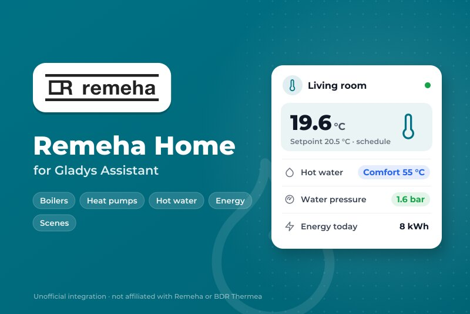
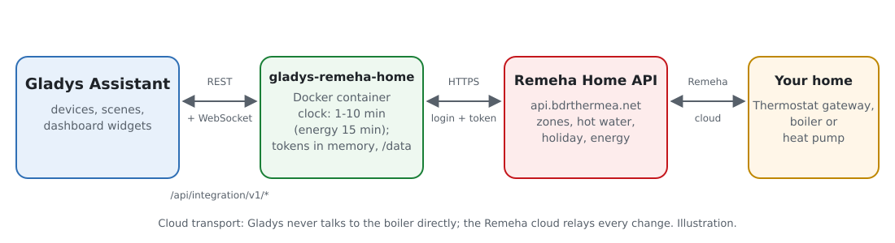
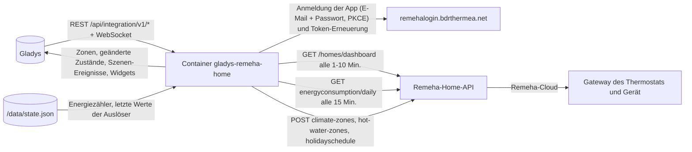
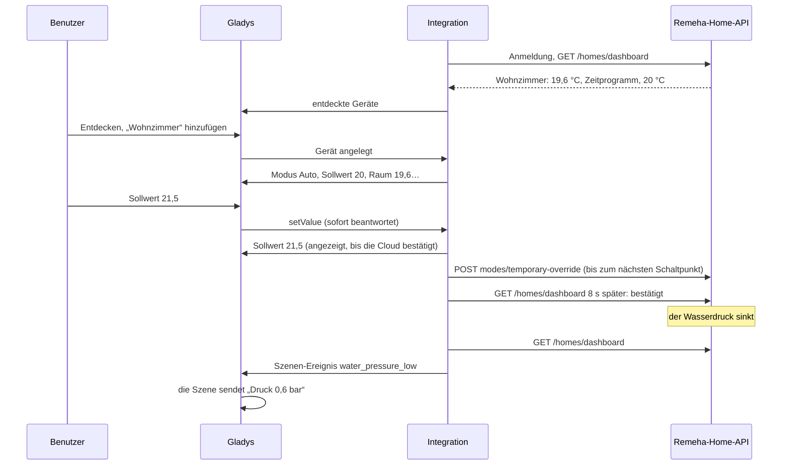
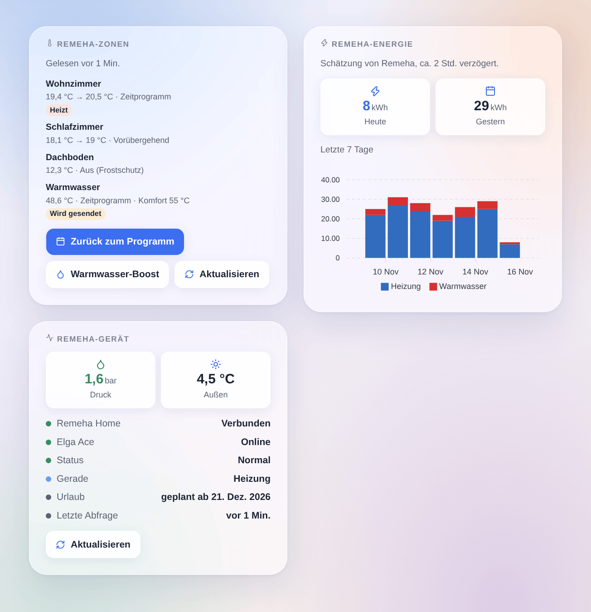
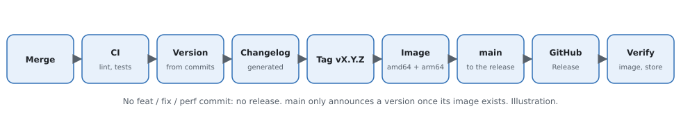

# Gladys Remeha Home

[English](README.md) · [Français](README.fr.md) · **Deutsch** · [Español](README.es.md)

[](LICENSE)
[](https://github.com/William-De71/gladys-remeha-home/releases)
[](https://github.com/William-De71/gladys-remeha-home/actions/workflows/release.yml)
[](https://gladysassistant.com)



Externe Integration für [Gladys Assistant](https://gladysassistant.com) für **Remeha Home**: jede Heizzone als Thermostat, das Warmwasser als Warmwasserbereiter mit Boost, und der Heizkessel oder die Wärmepumpe mit Wasserdruck, Außentemperatur und Energiezähler. Sie meldet sich mit Ihrem Remeha-Home-Konto an und bringt Szenen-Auslöser (Störung, niedriger Druck, offline, Urlaub), Aktionen (vorübergehende Temperatur, Zeitprogramm, Urlaub, Boost) und drei Dashboard-Widgets.

Benutzerdokumentation: [English](docs/en.md) · [Français](docs/fr.md) · [Deutsch](docs/de.md) · [Español](docs/es.md).

Nicht mit Remeha oder BDR Thermea verbunden. BDR Thermea veröffentlicht **keine Dokumentation** des Dienstes hinter der Remeha-Home-App: Anmeldung und Anfragen sind die, die die Community-Integration für Home Assistant nutzt und beschreibt ([msvisser/remeha_home](https://github.com/msvisser/remeha_home) und ihr gepflegter Fork [hugo-leij/remeha_home](https://github.com/hugo-leij/remeha_home)), und sie können sich ohne Vorankündigung ändern. **Noch nicht mit einem echten Remeha-Konto getestet**: Bitte melden Sie, was funktioniert und was nicht.

## Funktionen

- **Ein Thermostat pro Heizzone**: Modus (Zeitprogramm, manuell, aus), Solltemperatur in den Grenzen der Zone, Wärmeanforderung (`operating-state`), Raumtemperatur, Kaminmodus, wenn die Zone ihn hat.
- **Ein Warmwasserbereiter pro Warmwasserzone**: Zeitprogramm, Komfort, Eco und Boost, Komforttemperatur, Erwärmung ja oder nein, Wassertemperatur eines Speichers.
- **Ein Gerät pro Wärmeerzeuger**: Wasserdruck, Außentemperatur (Fühler oder Wetterdienst) und ein **Energiezähler** für das Energie-Dashboard von Gladys, aus der täglichen Schätzung von Remeha.
- Alle Zonen mit **einer Anfrage** alle 1, 2, 5 oder 10 Minuten gelesen; die Energie alle 15 Minuten, der Modellname einmal. Befehle werden sofort angezeigt und bei der nächsten Abfrage bestätigt.
- **5 Szenen-Auslöser**, **5 Szenen-Aktionen** und **3 Dashboard-Widgets** (unten), eine Schaltfläche **Verbindung testen**.
- Überall vier Sprachen: Englisch, Französisch, Deutsch, Spanisch.

## Funktionsweise





Von einem Sollwert zu einer Szene:



### Transport

`transports: ["cloud"]`: Die Anmeldung geht an `remehalogin.bdrthermea.net` und jede Anfrage an `api.bdrthermea.net`, mit Ihrem Remeha-Home-Konto; die Remeha-Cloud gibt Änderungen an das Gateway des Thermostats weiter. Die App bietet keinen lokalen Zugang. Passwort und Tokens bleiben im Speicher; `/data` enthält den Energiezähler jedes Geräts, die Werte der letzten Tage, die Modellnamen und die letzten Werte, die die Auslöser vergleichen.

## Geräte und Funktionen

| Gerät      | Funktion            | Kategorie / Typ                       | Einheit / Werte                   | Schreibbar |
| ---------- | ------------------- | ------------------------------------- | --------------------------------- | ---------- |
| Zone       | Modus               | `thermostat` / `mode`                 | Auto (Zeitprogramm), manuell, aus | ja         |
| Zone       | Solltemperatur      | `thermostat` / `target-temperature`   | °C, Grenzen der Zone, in 0,5      | ja         |
| Zone       | Wärmeanforderung    | `thermostat` / `operating-state`      | Ruhe, Heizen, Kühlen              | nein       |
| Zone       | Raumtemperatur      | `temperature-sensor` / `decimal`      | °C                                | nein       |
| Zone       | Kaminmodus          | `switch` / `binary`                   | an / aus (Zonen mit Kaminmodus)   | ja         |
| Warmwasser | Warmwassermodus     | `water-heater` / `mode`               | Programm, manuell, Eco, Boost     | ja         |
| Warmwasser | Komforttemperatur   | `water-heater` / `target-temperature` | °C, Grenzen der Zone, in 1        | ja         |
| Warmwasser | Wasser wird erwärmt | `water-heater` / `heating`            | 0 / 1                             | nein       |
| Warmwasser | Wassertemperatur    | `temperature-sensor` / `decimal`      | °C (nur Speicher)                 | nein       |
| Gerät      | Wasserdruck         | `pressure-sensor` / `decimal`         | bar                               | nein       |
| Gerät      | Außentemperatur     | `temperature-sensor` / `decimal`      | °C                                | nein       |
| Gerät      | Verbrauchte Energie | `energy-sensor` / `index`             | kWh (kumuliert)                   | nein       |

Ein neuer Sollwert einer Zone im Zeitprogramm ist wie in der App eine **vorübergehende Übersteuerung** bis zum nächsten Schaltpunkt; bei einer manuellen oder ausgeschalteten Zone ein fester manueller Sollwert. „Manuell“ beim Warmwasser ist der Komfortmodus der App (dauerhaft Komfort), „Eco“ ihr Eco-Modus. Remeha akzeptiert einen Boost nur aus dem Zeitprogramm: Die Integration wechselt bei Bedarf zuerst dorthin. Die Energie ist eine tägliche Schätzung von Remeha, etwa 2 Stunden verzögert: Die Integration addiert das Neue jedes Tages in einen in `/data` gehaltenen Zähler; bei einem Hybrid addiert sie wie Remeha Gas und Strom.

## Szenen-Auslöser, Aktionen und Widgets



Widgets:

- **Remeha-Zonen**: Temperatur, Sollwert und Modus jeder Zone und des Warmwassers, ein Abzeichen (heizt, kühlt, Befehl wird gesendet), nächster Schaltpunkt und Programm beim Antippen, **Zurück zum Programm** und **Warmwasser-Boost**, **Aktualisieren**. Einstellungen: die anzuzeigenden Zonen (höchstens 8).
- **Remeha-Energie**: Energie von heute und gestern, Balkendiagramm der letzten 7 Tage nach Nutzung. Einstellungen: die zu zählenden Geräte.
- **Remeha-Gerät**: Wasserdruck, Außentemperatur, Verbindung, Status, was das Gerät gerade tut, Urlaub, **Aktualisieren**. Einstellungen: das Gerät.

Szenen-Auslöser (jeweils nach Gerät filterbar): Das Gerät meldet eine Störung, ist wieder in Ordnung, der Wasserdruck wird zu niedrig, das Gerät geht offline oder wieder online, der Urlaub beginnt oder endet (in der App eingestellt, nie durch die Aktion).

Szenen-Aktionen: vorübergehende Temperatur setzen (für eine Dauer oder bis zum nächsten Schaltpunkt), Zeitprogramm 1, 2 oder 3 wählen, Urlaubsmodus einstellen (ab heute für N Tage, 0 zum Abbrechen), Warmwasser-Boost starten, Remeha Home jetzt abfragen.

Beispiele:

- Wenn jemand früher heimkommt → Wohnzimmer für 120 Minuten auf 21 °C.
- Wenn der Wasserdruck zu niedrig wird → Benachrichtigung „Druck {{triggerEvent.data.pressure}} bar“.
- Wenn das Gerät offline geht → benachrichtigen und das Gateway des Thermostats prüfen.

## Voraussetzungen

- Gladys Assistant **5.3.0** oder neuer (ältere Instanzen können sie nicht installieren).
- Ein Remeha-Gerät (oder Baxi, De Dietrich, Brötje in derselben Cloud), in der Remeha-Home-App mit seinem vernetzten Thermostat sichtbar, sowie E-Mail und Passwort der App.

## Installation

- **Aus dem Store**: Integrationen → Remeha Home → Installieren.
- **Über die Repository-URL**: Integrationen → externe Integration → `https://github.com/William-De71/gladys-remeha-home`.
- **Entwicklermodus**: `npm start` mit den von Gladys gelieferten Variablen starten (siehe Entwicklung).

## Konfiguration

| Feld oder Schaltfläche  | Standard    | Bedeutung                                                                   |
| ----------------------- | ----------- | --------------------------------------------------------------------------- |
| E-Mail                  | —           | Pflichtfeld, die E-Mail des Remeha-Home-Kontos                              |
| Passwort                | —           | Pflichtfeld, geheim: im Speicher, nie wieder angezeigt, nie protokolliert   |
| Abfrageintervall        | 2 Min.      | 1, 2, 5 oder 10 Minuten; eine Anfrage für alle Zonen                        |
| Sprache der Gerätetexte | automatisch | Funktionsnamen und Meldungen der Schaltfläche                               |
| Verbindung testen       | —           | Meldet sich jetzt an und listet die gefundenen Zonen, Warmwasser und Geräte |

## Verwendung

1. E-Mail und Passwort eingeben, dann **Verbindung testen** drücken (Integrationen → Remeha Home → Konfiguration).
2. **Entdecken**: die Zonen, das Warmwasser und das Gerät hinzufügen.
3. Die Widgets **Remeha-Zonen** und **Remeha-Gerät** einem Dashboard hinzufügen.
4. Szenen mit den Gerätefunktionen, Auslösern und Aktionen bauen.

## Entwicklung

```bash
npm install
npm test                       # node --test, nie mit Netzwerk
npm run lint                   # ESLint
npm run format:check           # Prettier
npx github:GladysAssistant/integration-store . --skip-image-check
scripts/build-cover.sh         # cover.jpg aus docs/assets/cover.svg
docs/illustrations/render.sh   # docs/assets/widgets.<Sprache>.png
```

Lokal liest das SDK `GLADYS_HOST_API_URL`, `GLADYS_INTEGRATION_TOKEN` und `GLADYS_INTEGRATION_SELECTOR` (von Gladys im Entwicklermodus geliefert), und die Integration liest `TZ` (Sprachvermutung, und die Tage, wenn Remeha keine Zeitzone liefert). `DEBUG=gladys-integration-sdk` zeigt die Logs des SDK.

Die Tests decken den API-Client ab (Anmeldung der App mit Cookies, CSRF und PKCE, Wiederverwendung und Erneuerung des Tokens, abgelehntes Refresh-Token, falsche Zugangsdaten, 401 / 429 / Problem Details, nicht erreichbarer Dienst, Abstand, Inhalte der Schreibzugriffe), das Datenmodell (vorsichtig gelesene Felder, lokale Zeiten mit Z, Modi, Sollwerte, einmal gezählte Tagesenergie), die Geräte (vom Entdecken-Bildschirm verlangte Felder, Kategorie-/Typ-Paare), die Auslöser, die Widgets (`validateWidgetContent`), das Manifest, die vier Sprachen, das Release-Skript und die ganze Integration gegen das Fake-Gladys des SDK und eine Fake-API (befohlene Werte, Ablehnungen, Drosselung, Neustart). `test/structure.test.js` friert alle von Benutzern gespeicherten Schlüssel ein.

## Release-Prozess



Jeder Merge auf `main` startet die CI und berechnet dann die Version aus den [Conventional Commits](https://www.conventionalcommits.org/) seit dem letzten Tag: `feat` → Minor, `fix` / `perf` → Patch, `!` oder `BREAKING CHANGE` → Major (Minor unter 1.0.0); `docs`, `chore`, `ci`, `test`, `style`, `refactor`, `build` allein veröffentlichen nichts. Der Changelog-Abschnitt wird erzeugt, der Tag gepusht, das Multi-Architektur-Image gebaut, dann erhält `main` den Release-Commit, das GitHub Release wird erstellt und ein letzter Job prüft das öffentliche Image, den Store-Validator und das Topic.

- Der Titel des Pull Requests wird zum Squash-Commit und dann zur Changelog-Zeile: auf Englisch, für den Benutzer (`pr-title.yml` prüft ihn). `CHANGELOG.md` nie von Hand ändern.
- 1.0.0 ist eine Entscheidung: Actions → Release → Run workflow mit `release-as: 1.0.0`. `dry-run` zeigt Version und Notizen ohne Veröffentlichung.
- **Geschützter Branch**: Das Release pusht seinen Commit mit `GITHUB_TOKEN` auf `main`. Das Ruleset `protect-main` (kein Löschen, kein Force-Push) lässt ihn durch; eine strengere Regel (Pull Request Pflicht, Status Checks) bräuchte GitHub Actions in der Bypass-Liste oder eine GitHub App.
- Nach dem ersten Release das Paket auf `ghcr.io` öffentlich machen (Package settings → Change visibility), sonst kann Gladys es nicht laden.

## Fehlerbehebung

Siehe [docs/de.md](docs/de.md#fehlerbehebung). Melden Sie Probleme mit den Versionen von Gladys und der Integration, dem Modell Ihres Geräts und Thermostats, dem Ergebnis von „Verbindung testen“ und den Logs der Integration. Fügen Sie nie Ihre E-Mail oder Ihr Passwort ein.

## Mitwirken

Issues und Pull Requests sind willkommen. Führen Sie vor einem Pull Request `npm run format:check && npm run lint && npm test` aus und lassen Sie alle externen IDs und gespeicherten Schlüssel unverändert (siehe [CLAUDE.md](CLAUDE.md)).

## Sicherheit

Siehe [SECURITY.md](SECURITY.md): Schwachstellen bitte vertraulich melden. Das Passwort ist ein Feld vom Typ `secret`: nie protokolliert, nie in `/data` geschrieben, nur zur Anmeldung per HTTPS an `remehalogin.bdrthermea.net` gesendet; die Tokens bleiben im Speicher, und weder sie noch das Passwort erscheinen in einer Fehlermeldung. BDR Thermea bietet keinen separaten Zugang für Dritte: Die Integration besitzt das Passwort Ihres Kontos; ändern Sie es in der Remeha-Home-App, um den Zugang zu widerrufen.

## Kommende Screenshots

Die Bilder oben sind Illustrationen, keine Screenshots. Echte Screenshots kommen in `docs/assets/screenshots/` (PNG, 1280 × 800): `configuration.png` (Zugangsdaten und „Verbindung testen“), `discovery.png`, `thermostat.png` (eine Zone im Dashboard), `scene.png`.

## Lizenz

[Apache License 2.0](LICENSE) — siehe auch [NOTICE](NOTICE). Remeha, Baxi, De Dietrich und Brötje sind Marken der BDR Thermea Group. Die Fakten zur API stammen aus [msvisser/remeha_home](https://github.com/msvisser/remeha_home) und [hugo-leij/remeha_home](https://github.com/hugo-leij/remeha_home), genannt in NOTICE; kein Code wurde kopiert. Dank an die Dokumentation und das SDK von Gladys.
