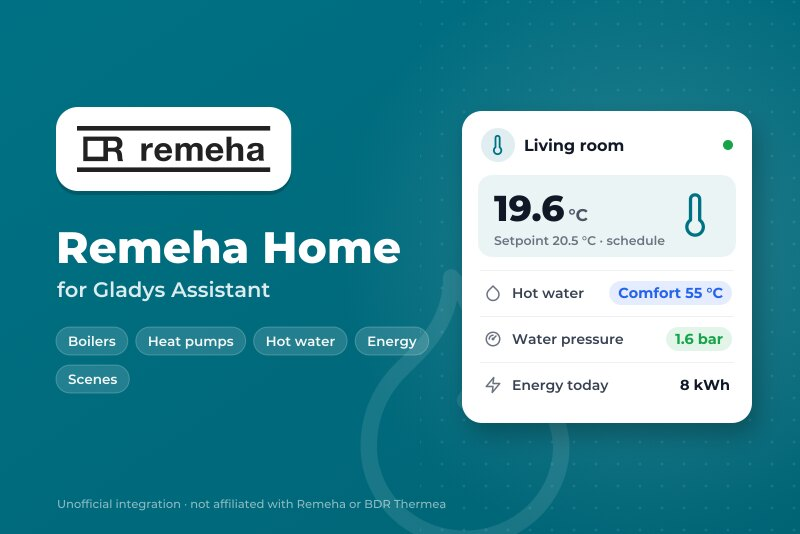
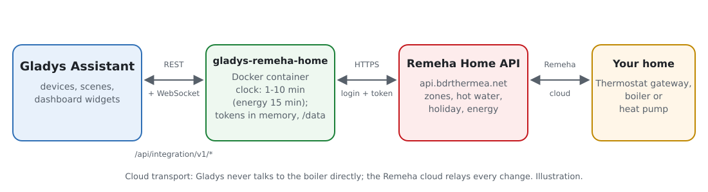
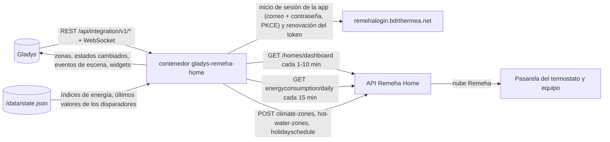
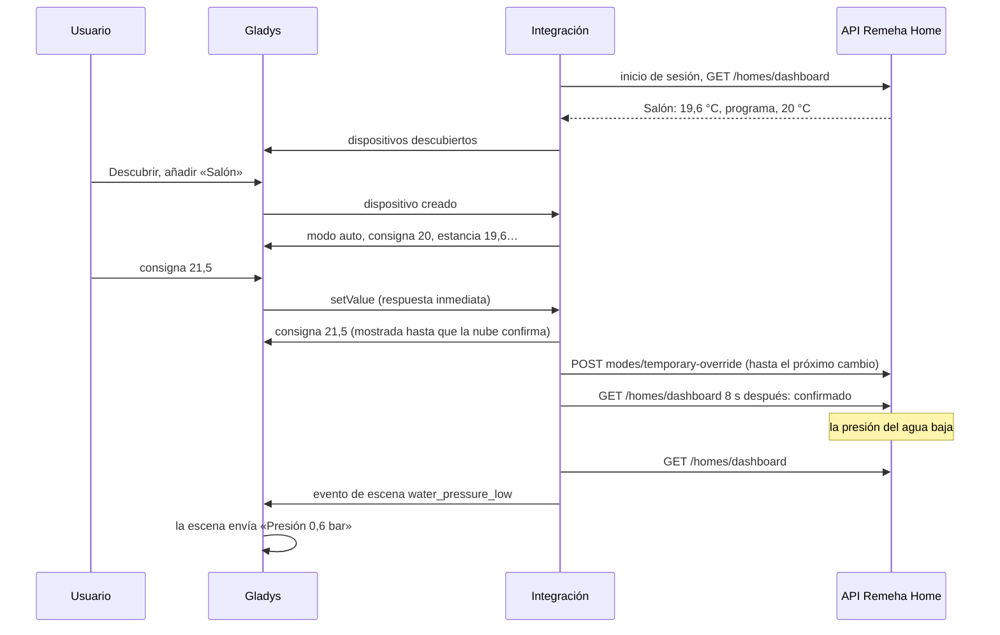

# Gladys Remeha Home

[English](README.md) · [Français](README.fr.md) · [Deutsch](README.de.md) · **Español**

[](LICENSE)
[](https://github.com/William-De71/gladys-remeha-home/releases)
[](https://github.com/William-De71/gladys-remeha-home/actions/workflows/release.yml)
[](https://gladysassistant.com)



Integración externa de [Gladys Assistant](https://gladysassistant.com) para **Remeha Home**: cada zona de calefacción como termostato, el agua caliente como calentador con su boost, y la caldera o la bomba de calor con su presión del agua, su temperatura exterior y un índice de energía. Inicia sesión con su cuenta Remeha Home y añade disparadores de escena (avería, presión baja, desconexión, vacaciones), acciones (temperatura temporal, programa horario, vacaciones, boost) y tres widgets.

Documentación de usuario: [English](docs/en.md) · [Français](docs/fr.md) · [Deutsch](docs/de.md) · [Español](docs/es.md).

Sin relación con Remeha ni BDR Thermea. BDR Thermea **no publica documentación** del servicio de la app Remeha Home: el inicio de sesión y las peticiones son los que usa y describe la integración comunitaria para Home Assistant ([msvisser/remeha_home](https://github.com/msvisser/remeha_home) y su fork mantenido [hugo-leij/remeha_home](https://github.com/hugo-leij/remeha_home)), y pueden cambiar sin previo aviso. **Aún no probada con una cuenta Remeha real**: indíquenos qué funciona y qué no.

## Funciones

- **Un termostato por zona**: modo (programa horario, manual, apagado), consigna dentro de los límites de la zona, demanda de calor (`operating-state`), temperatura ambiente, modo chimenea cuando la zona lo tiene.
- **Un calentador por zona de agua caliente**: programa horario, confort, eco y boost, temperatura confort, calentando o no, temperatura del agua de un acumulador.
- **Un dispositivo por equipo**: presión del agua, temperatura exterior (sonda o servicio meteorológico) y un **índice de energía** para el panel de energía de Gladys, a partir de la estimación diaria de Remeha.
- Todas las zonas leídas con **una petición** cada 1, 2, 5 o 10 minutos; la energía cada 15 minutos, el nombre del modelo una vez. Las órdenes se muestran al instante y se confirman en la siguiente lectura.
- **5 disparadores de escena**, **5 acciones de escena** y **3 widgets** (abajo), un botón **Probar la conexión**.
- Cuatro idiomas en todas partes: inglés, francés, alemán, español.

## Cómo funciona





De una consigna a una escena:



### Transporte

`transports: ["cloud"]`: el inicio de sesión va a `remehalogin.bdrthermea.net` y cada petición a `api.bdrthermea.net`, con su cuenta Remeha Home; la nube de Remeha transmite los cambios a la pasarela del termostato. La app no ofrece acceso local. La contraseña y los tokens se quedan en memoria; `/data` guarda el índice de energía de cada equipo, las cifras de los últimos días, los nombres de modelo y los últimos valores que comparan los disparadores.

## Dispositivos y funciones

| Dispositivo   | Función              | Categoría / tipo                      | Unidad / valores                      | Modificable |
| ------------- | -------------------- | ------------------------------------- | ------------------------------------- | ----------- |
| Zona          | Modo                 | `thermostat` / `mode`                 | auto (programa), manual, apagado      | sí          |
| Zona          | Consigna             | `thermostat` / `target-temperature`   | °C, límites de la zona, de 0,5 en 0,5 | sí          |
| Zona          | Demanda de calor     | `thermostat` / `operating-state`      | reposo, calor, frío                   | no          |
| Zona          | Temperatura ambiente | `temperature-sensor` / `decimal`      | °C                                    | no          |
| Zona          | Modo chimenea        | `switch` / `binary`                   | sí / no (zonas que lo tienen)         | sí          |
| Agua caliente | Modo agua caliente   | `water-heater` / `mode`               | programa, manual, eco, boost          | sí          |
| Agua caliente | Temperatura confort  | `water-heater` / `target-temperature` | °C, límites de la zona, de 1 en 1     | sí          |
| Agua caliente | Calentando agua      | `water-heater` / `heating`            | 0 / 1                                 | no          |
| Agua caliente | Temperatura del agua | `temperature-sensor` / `decimal`      | °C (solo acumulador)                  | no          |
| Equipo        | Presión del agua     | `pressure-sensor` / `decimal`         | bar                                   | no          |
| Equipo        | Temperatura exterior | `temperature-sensor` / `decimal`      | °C                                    | no          |
| Equipo        | Energía consumida    | `energy-sensor` / `index`             | kWh (acumulados)                      | no          |

Una nueva consigna en una zona que sigue su programa es una **anulación temporal** hasta el próximo cambio, como en la app; en una zona en manual o apagada, una consigna manual fija. «Manual» para el agua caliente es el modo Confort de la app (confort siempre), «eco» su modo Eco. Remeha solo acepta un boost desde el programa horario: la integración vuelve antes a él si hace falta. La energía es una estimación diaria de Remeha, con unas 2 horas de retraso: la integración suma lo nuevo de cada día en un índice guardado en `/data`; en un híbrido suma gas y electricidad, como Remeha.

## Disparadores, acciones de escena y widgets


Widgets:

- **Zonas Remeha**: temperatura, consigna y modo de cada zona y del agua caliente, una insignia (calentando, enfriando, orden enviándose), el próximo cambio y el programa al tocar, **Volver al programa** y **Boost agua caliente**, **Actualizar**. Ajustes: las zonas que mostrar (8 como máximo).
- **Energía Remeha**: energía de hoy y de ayer, gráfico de barras de los últimos 7 días por uso. Ajustes: los equipos que contar.
- **Equipo Remeha**: presión del agua, temperatura exterior, conexión, estado, lo que hace ahora el equipo, vacaciones, **Actualizar**. Ajustes: el equipo.

Disparadores (cada uno filtrable por equipo): el equipo indica una avería, vuelve a la normalidad, la presión del agua es demasiado baja, el equipo se desconecta o se reconecta, empiezan o terminan las vacaciones (ajustadas en la app, nunca por la acción).

Acciones: fijar una temperatura temporal (durante un tiempo o hasta el próximo cambio), elegir el programa horario 1, 2 o 3, ajustar el modo vacaciones (desde hoy N días, 0 para cancelar), iniciar un boost de agua caliente, leer Remeha Home ahora.

Ejemplos:

- Cuando alguien vuelve antes → poner el salón a 21 °C durante 120 minutos.
- Cuando la presión del agua es demasiado baja → notificar «Presión {{triggerEvent.data.pressure}} bar».
- Cuando el equipo se desconecta → notificar, y comprobar la pasarela del termostato.

## Requisitos

- Gladys Assistant **5.3.0** o posterior (las instancias anteriores no pueden instalarla).
- Un equipo Remeha (o Baxi, De Dietrich, Brötje en la misma nube) visible en la app Remeha Home con su termostato conectado, y el correo y la contraseña de la app.

## Instalación

- **Desde la tienda**: Integraciones → Remeha Home → Instalar.
- **Desde la URL del repositorio**: Integraciones → integración externa → `https://github.com/William-De71/gladys-remeha-home`.
- **Modo desarrollador**: ejecute `npm start` con las variables que da Gladys (ver Desarrollo).

## Configuración

| Campo o botón                            | Por defecto | Significado                                                           |
| ---------------------------------------- | ----------- | --------------------------------------------------------------------- |
| Correo electrónico                       | —           | Obligatorio, el correo de la cuenta Remeha Home                       |
| Contraseña                               | —           | Obligatoria, secreta: en memoria, nunca se muestra ni se registra     |
| Intervalo de lectura                     | 2 min       | 1, 2, 5 o 10 minutos; una petición para todas las zonas               |
| Idioma de los textos de los dispositivos | automático  | Nombres de las funciones y mensajes del botón                         |
| Probar la conexión                       | —           | Inicia sesión ahora y lista las zonas, el agua caliente y los equipos |

## Uso

1. Introduzca el correo y la contraseña, luego pulse **Probar la conexión** (Integraciones → Remeha Home → Configuración).
2. **Descubrir**: añada las zonas, el agua caliente y el equipo.
3. Añada los widgets **Zonas Remeha** y **Equipo Remeha** a un panel.
4. Cree escenas con las funciones de los dispositivos, los disparadores y las acciones.

## Desarrollo

```bash
npm install
npm test                       # node --test, nunca toca la red
npm run lint                   # ESLint
npm run format:check           # Prettier
npx github:GladysAssistant/integration-store . --skip-image-check
scripts/build-cover.sh         # cover.jpg desde docs/assets/cover.svg
docs/illustrations/render.sh   # docs/assets/widgets.<idioma>.png
```

En local, el SDK lee `GLADYS_HOST_API_URL`, `GLADYS_INTEGRATION_TOKEN` y `GLADYS_INTEGRATION_SELECTOR` (dados por Gladys en modo desarrollador), y la integración lee `TZ` (idioma deducido, y los días cuando Remeha no da zona horaria). `DEBUG=gladys-integration-sdk` muestra los registros del SDK.

Las pruebas cubren el cliente de la API (inicio de sesión de la app con cookies, CSRF y PKCE, reutilización y renovación del token, token de renovación rechazado, credenciales incorrectas, 401 / 429 / problem details, servicio inaccesible, espaciado, cuerpos de las escrituras), el modelo de datos (campos leídos con cuidado, horas locales escritas con Z, modos, consignas, energía diaria contada una vez), los dispositivos (campos que exige la pantalla Descubrir, pares categoría / tipo), los disparadores, los widgets (`validateWidgetContent`), el manifiesto, los cuatro idiomas, el script de publicación y toda la integración contra el Gladys falso del SDK y una API falsa (valores ordenados, rechazos, ralentización, reinicio). `test/structure.test.js` congela todas las claves que guardan los usuarios.

## Proceso de publicación


Cada fusión en `main` ejecuta la CI y después calcula la versión a partir de los [Conventional Commits](https://www.conventionalcommits.org/) desde la última etiqueta: `feat` → menor, `fix` / `perf` → parche, `!` o `BREAKING CHANGE` → mayor (menor por debajo de 1.0.0); `docs`, `chore`, `ci`, `test`, `style`, `refactor`, `build` solos no publican nada. Se genera la sección del changelog, se sube la etiqueta, se construye la imagen multiarquitectura, luego `main` recibe el commit de publicación, se crea la GitHub Release y un último job comprueba la imagen pública, el validador de la tienda y el topic.

- El título de la pull request se convierte en el commit squash y luego en la línea del changelog: escríbalo en inglés, para el usuario (`pr-title.yml` lo comprueba). Nunca edite `CHANGELOG.md` a mano.
- 1.0.0 es una decisión: Actions → Release → Run workflow con `release-as: 1.0.0`. `dry-run` muestra la versión y las notas sin publicar.
- **Rama protegida**: la publicación sube su commit a `main` con `GITHUB_TOKEN`. El ruleset `protect-main` (sin borrado ni force-push) lo deja pasar; una regla más estricta (pull request obligatoria, status checks) necesitaría GitHub Actions en la lista de excepciones, o una GitHub App.
- Tras la primera publicación, haga público el paquete `ghcr.io` (Package settings → Change visibility), si no Gladys no puede descargarlo.

## Solución de problemas

Ver [docs/es.md](docs/es.md#solución-de-problemas). Indique los problemas con las versiones de Gladys y de la integración, el modelo de su equipo y termostato, el resultado de «Probar la conexión» y los registros de la integración. Nunca pegue su correo ni su contraseña.

## Contribuir

Issues y pull requests bienvenidas. Ejecute `npm run format:check && npm run lint && npm test` antes de abrir una pull request, y no cambie ningún id externo ni clave guardada (ver [CLAUDE.md](CLAUDE.md)).

## Seguridad

Ver [SECURITY.md](SECURITY.md): indique las vulnerabilidades en privado. La contraseña es un campo `secret`: nunca se registra, nunca se escribe en `/data`, solo se envía a `remehalogin.bdrthermea.net` por HTTPS para iniciar sesión; los tokens se quedan en memoria y ni ellos ni la contraseña aparecen en un mensaje de error. BDR Thermea no ofrece acceso separado para terceros: la integración tiene la contraseña de su cuenta; cámbiela en la app Remeha Home para revocar el acceso.

## Capturas por venir

Las imágenes anteriores son ilustraciones, no capturas de pantalla. Las capturas reales irán en `docs/assets/screenshots/` (PNG, 1280 × 800): `configuration.png` (credenciales y «Probar la conexión»), `discovery.png`, `thermostat.png` (una zona en el panel), `scene.png`.

## Licencia

[Apache License 2.0](LICENSE) — ver también [NOTICE](NOTICE). Remeha, Baxi, De Dietrich y Brötje son marcas del grupo BDR Thermea. Los datos sobre la API vienen de [msvisser/remeha_home](https://github.com/msvisser/remeha_home) y de [hugo-leij/remeha_home](https://github.com/hugo-leij/remeha_home), citados en NOTICE; no se copió código. Gracias a la documentación y al SDK de Gladys.
