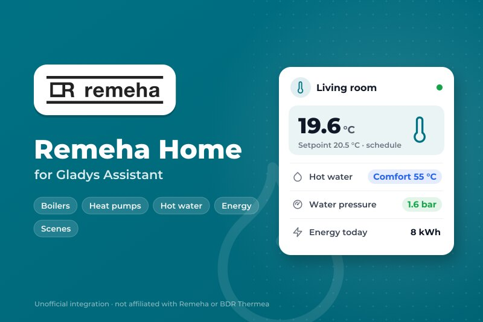
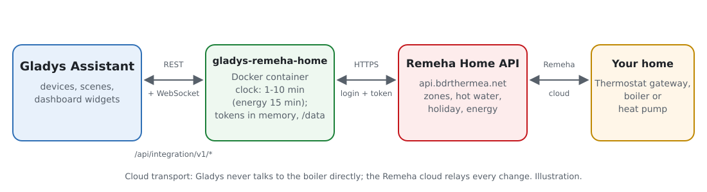
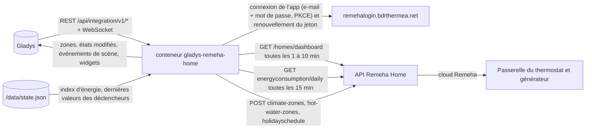
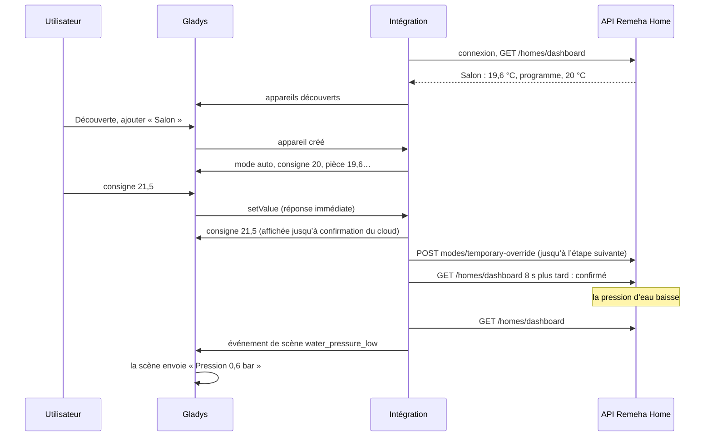

# Gladys Remeha Home

[English](README.md) · **Français** · [Deutsch](README.de.md) · [Español](README.es.md)

[](LICENSE)
[](https://github.com/William-De71/gladys-remeha-home/releases)
[](https://github.com/William-De71/gladys-remeha-home/actions/workflows/release.yml)
[](https://gladysassistant.com)



Intégration externe [Gladys Assistant](https://gladysassistant.com) pour **Remeha Home** : chaque zone de chauffage devient un thermostat, l’eau chaude un chauffe-eau avec son boost, et la chaudière ou la pompe à chaleur un appareil avec sa pression d’eau, sa température extérieure et un index d’énergie. Elle se connecte avec votre compte Remeha Home et ajoute des déclencheurs de scène (défaut, pression basse, déconnexion, vacances), des actions (température temporaire, programme horaire, vacances, boost) et trois widgets.

Documentation utilisateur : [English](docs/en.md) · [Français](docs/fr.md) · [Deutsch](docs/de.md) · [Español](docs/es.md).

Sans lien avec Remeha ni BDR Thermea. BDR Thermea ne publie **aucune documentation** du service de l’application Remeha Home : la connexion et les requêtes sont celles qu’utilise et documente l’intégration communautaire pour Home Assistant ([msvisser/remeha_home](https://github.com/msvisser/remeha_home) et son fork maintenu [hugo-leij/remeha_home](https://github.com/hugo-leij/remeha_home)), et elles peuvent changer sans préavis. **Pas encore testée avec un vrai compte Remeha** : dites-nous ce qui marche et ce qui ne marche pas.

## Fonctionnalités

- **Un thermostat par zone** : mode (programme horaire, manuel, arrêt), consigne dans les limites de la zone, demande de chauffe (`operating-state`), température de la pièce, mode cheminée quand la zone en a un.
- **Un chauffe-eau par zone d’eau chaude** : programme horaire, confort, éco et boost, température confort, chauffe en cours, température de l’eau d’un ballon.
- **Un appareil par générateur** : pression d’eau, température extérieure (sonde ou service météo) et un **index d’énergie** pour le tableau de bord énergie de Gladys, d’après l’estimation quotidienne de Remeha.
- Toutes les zones relevées en **une requête** toutes les 1, 2, 5 ou 10 minutes ; l’énergie toutes les 15 minutes, le nom du modèle une fois. Les commandes s’affichent aussitôt et sont confirmées au relevé suivant.
- **5 déclencheurs de scène**, **5 actions de scène** et **3 widgets** (ci-dessous), un bouton **Tester la connexion**.
- Quatre langues partout : anglais, français, allemand, espagnol.

## Fonctionnement





D’une consigne à une scène :



### Transport

`transports: ["cloud"]` : la connexion passe par `remehalogin.bdrthermea.net` et chaque requête par `api.bdrthermea.net`, avec votre compte Remeha Home ; le cloud Remeha relaie les changements à la passerelle du thermostat. L’application n’offre aucun accès local. Le mot de passe et les jetons restent en mémoire ; `/data` garde l’index d’énergie de chaque générateur, les chiffres des derniers jours, les noms de modèle et les dernières valeurs comparées par les déclencheurs.

## Appareils et fonctionnalités

| Appareil   | Fonctionnalité          | Catégorie / type                      | Unité / valeurs                  | Modifiable |
| ---------- | ----------------------- | ------------------------------------- | -------------------------------- | ---------- |
| Zone       | Mode                    | `thermostat` / `mode`                 | auto (programme), manuel, arrêt  | oui        |
| Zone       | Consigne                | `thermostat` / `target-temperature`   | °C, limites de la zone, par 0,5  | oui        |
| Zone       | Demande de chauffe      | `thermostat` / `operating-state`      | repos, chauffe, rafraîchissement | non        |
| Zone       | Température de la pièce | `temperature-sensor` / `decimal`      | °C                               | non        |
| Zone       | Mode cheminée           | `switch` / `binary`                   | marche / arrêt (zones qui l’ont) | oui        |
| Eau chaude | Mode eau chaude         | `water-heater` / `mode`               | programme, manuel, éco, boost    | oui        |
| Eau chaude | Température confort     | `water-heater` / `target-temperature` | °C, limites de la zone, par 1    | oui        |
| Eau chaude | Chauffe de l’eau        | `water-heater` / `heating`            | 0 / 1                            | non        |
| Eau chaude | Température de l’eau    | `temperature-sensor` / `decimal`      | °C (ballon seulement)            | non        |
| Générateur | Pression d’eau          | `pressure-sensor` / `decimal`         | bar                              | non        |
| Générateur | Température extérieure  | `temperature-sensor` / `decimal`      | °C                               | non        |
| Générateur | Énergie consommée       | `energy-sensor` / `index`             | kWh (cumulés)                    | non        |

Une nouvelle consigne sur une zone qui suit son programme est une **dérogation temporaire** jusqu’à l’étape suivante, comme dans l’application ; sur une zone en manuel ou à l’arrêt, une consigne manuelle fixe. « Manuel » pour l’eau chaude est le mode Confort de l’application (confort en continu), « éco » son mode Éco. Remeha n’accepte un boost que depuis le programme horaire : l’intégration y repasse d’abord si besoin. L’énergie est une estimation quotidienne de Remeha, avec environ 2 heures de retard : l’intégration ajoute ce qui est nouveau de chaque jour dans un index gardé dans `/data` ; sur un hybride, elle additionne gaz et électricité, comme Remeha.

## Déclencheurs, actions de scène et widgets


Widgets :

- **Zones Remeha** : température, consigne et mode de chaque zone et de l’eau chaude, un badge (chauffe, rafraîchit, commande en cours d’envoi), l’étape suivante et le programme au toucher, **Retour au programme** et **Boost eau chaude**, **Actualiser**. Réglages : les zones à afficher (8 au plus).
- **Énergie Remeha** : énergie d’aujourd’hui et d’hier, graphique en barres des 7 derniers jours par usage. Réglages : les générateurs à compter.
- **Générateur Remeha** : pression d’eau, température extérieure, connexion, état, ce que fait le générateur, vacances, **Actualiser**. Réglages : le générateur.

Déclencheurs (chacun filtré par générateur) : le générateur signale un défaut, revient à la normale, la pression d’eau devient trop basse, le générateur se déconnecte ou se reconnecte, les vacances commencent ou se terminent (réglées dans l’application, jamais par l’action).

Actions : imposer une température temporaire (pour une durée ou jusqu’à l’étape suivante), choisir le programme horaire 1, 2 ou 3, régler le mode vacances (dès aujourd’hui pour N jours, 0 pour annuler), lancer un boost d’eau chaude, relever Remeha Home maintenant.

Exemples :

- Quand quelqu’un rentre plus tôt → imposer 21 °C au salon pendant 120 minutes.
- Quand la pression d’eau devient trop basse → notifier « Pression {{triggerEvent.data.pressure}} bar ».
- Quand le générateur se déconnecte → notifier, et vérifier la passerelle du thermostat.

## Prérequis

- Gladys Assistant **5.3.0** ou plus récent (les instances plus anciennes ne peuvent pas l’installer).
- Un générateur Remeha (ou Baxi, De Dietrich, Brötje sur le même cloud) visible dans l’application Remeha Home avec son thermostat connecté, et l’e-mail et le mot de passe de l’application.

## Installation

- **Depuis le store** : Intégrations → Remeha Home → Installer.
- **Depuis l’URL du dépôt** : Intégrations → intégration externe → `https://github.com/William-De71/gladys-remeha-home`.
- **Mode développeur** : lancez `npm start` avec les variables fournies par Gladys (voir Développement).

## Configuration

| Champ ou bouton                 | Défaut      | Rôle                                                                       |
| ------------------------------- | ----------- | -------------------------------------------------------------------------- |
| E-mail                          | —           | Obligatoire, l’e-mail du compte Remeha Home                                |
| Mot de passe                    | —           | Obligatoire, secret : gardé en mémoire, jamais réaffiché ni journalisé     |
| Intervalle de relevé            | 2 min       | 1, 2, 5 ou 10 minutes ; une requête pour toutes les zones                  |
| Langue des textes des appareils | automatique | Noms des fonctionnalités et messages du bouton                             |
| Tester la connexion             | —           | Se connecte maintenant et liste les zones, l’eau chaude et les générateurs |

## Utilisation

1. Saisissez l’e-mail et le mot de passe, puis cliquez sur **Tester la connexion** (Intégrations → Remeha Home → Configuration).
2. **Découverte** : ajoutez les zones, l’eau chaude et le générateur.
3. Ajoutez les widgets **Zones Remeha** et **Générateur Remeha** à un tableau de bord.
4. Construisez vos scènes avec les fonctionnalités, les déclencheurs et les actions.

## Développement

```bash
npm install
npm test                       # node --test, sans jamais toucher au réseau
npm run lint                   # ESLint
npm run format:check           # Prettier
npx github:GladysAssistant/integration-store . --skip-image-check
scripts/build-cover.sh         # cover.jpg depuis docs/assets/cover.svg
docs/illustrations/render.sh   # docs/assets/widgets.<langue>.png
```

En local, le SDK lit `GLADYS_HOST_API_URL`, `GLADYS_INTEGRATION_TOKEN` et `GLADYS_INTEGRATION_SELECTOR` (fournis par Gladys en mode développeur), et l’intégration lit `TZ` (langue devinée, et les jours quand Remeha ne donne pas de fuseau). `DEBUG=gladys-integration-sdk` affiche les logs du SDK.

Les tests couvrent le client de l’API (connexion de l’application avec cookies, CSRF et PKCE, réutilisation et renouvellement du jeton, jeton de renouvellement refusé, mauvais identifiants, 401 / 429 / problem details, service injoignable, espacement, corps des écritures), le modèle de données (champs lus prudemment, heures locales écrites avec un Z, modes, consignes, énergie quotidienne comptée une fois), les appareils (champs exigés par l’écran Découverte, couples catégorie / type), les déclencheurs, les widgets (`validateWidgetContent`), le manifeste, les quatre langues, le script de release, et toute l’intégration contre le faux Gladys du SDK et une fausse API (valeurs commandées, refus, ralentissement, redémarrage). `test/structure.test.js` fige toutes les clés que les utilisateurs enregistrent.

## Processus de release


Chaque fusion sur `main` lance la CI, puis calcule la version d’après les [Conventional Commits](https://www.conventionalcommits.org/) depuis le dernier tag : `feat` → mineure, `fix` / `perf` → correctif, `!` ou `BREAKING CHANGE` → majeure (mineure sous 1.0.0) ; `docs`, `chore`, `ci`, `test`, `style`, `refactor`, `build` seuls ne publient rien. La section du changelog est générée, le tag poussé, l’image multi-architecture construite, puis `main` reçoit le commit de release, la GitHub Release est créée et un dernier job vérifie l’image publique, le validateur du store et le topic.

- Le titre de la pull request devient le commit squash, puis la ligne du changelog : écrivez-le en anglais, pour l’utilisateur (`pr-title.yml` le vérifie). Ne modifiez jamais `CHANGELOG.md` à la main.
- 1.0.0 est une décision : Actions → Release → Run workflow avec `release-as: 1.0.0`. `dry-run` affiche la version et les notes sans rien publier.
- **Branche protégée** : la release pousse son commit sur `main` avec `GITHUB_TOKEN`. Le ruleset `protect-main` (ni suppression ni force-push) le laisse passer ; une règle plus stricte (pull request obligatoire, status checks) demanderait d’ajouter GitHub Actions à la liste de contournement, ou une GitHub App.
- Après la première release, rendez public le package `ghcr.io` (Package settings → Change visibility), sinon Gladys ne peut pas le télécharger.

## Dépannage

Voir [docs/fr.md](docs/fr.md#dépannage). Signalez un problème avec les versions de Gladys et de l’intégration, le modèle de votre générateur et de votre thermostat, le résultat de « Tester la connexion » et les logs de l’intégration. Ne collez jamais votre e-mail ni votre mot de passe.

## Contribuer

Issues et pull requests bienvenues. Lancez `npm run format:check && npm run lint && npm test` avant d’ouvrir une pull request, et ne changez aucun identifiant externe ni aucune clé enregistrée (voir [CLAUDE.md](CLAUDE.md)).

## Sécurité

Voir [SECURITY.md](SECURITY.md) : signalez les failles en privé. Le mot de passe est un champ `secret` : jamais journalisé, jamais écrit dans `/data`, envoyé uniquement à `remehalogin.bdrthermea.net` en HTTPS pour se connecter ; les jetons restent en mémoire et ni eux ni le mot de passe n’apparaissent dans un message d’erreur. BDR Thermea ne propose pas d’accès séparé pour les tiers : l’intégration détient le mot de passe de votre compte, changez-le dans l’application Remeha Home pour révoquer l’accès.

## Captures à venir

Les images ci-dessus sont des illustrations, pas des captures d’écran. Les vraies captures iront dans `docs/assets/screenshots/` (PNG, 1280 × 800) : `configuration.png` (identifiants et « Tester la connexion »), `discovery.png`, `thermostat.png` (une zone sur le tableau de bord), `scene.png`.

## Licence

[Apache License 2.0](LICENSE) — voir aussi [NOTICE](NOTICE). Remeha, Baxi, De Dietrich et Brötje sont des marques du groupe BDR Thermea. Les faits sur l’API viennent de [msvisser/remeha_home](https://github.com/msvisser/remeha_home) et de [hugo-leij/remeha_home](https://github.com/hugo-leij/remeha_home), cités dans NOTICE ; aucun code n’a été copié. Merci à la documentation et au SDK de Gladys.
