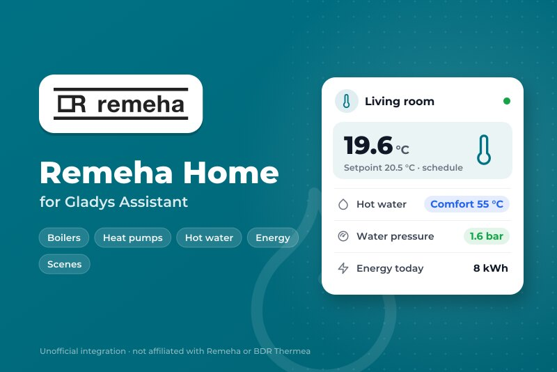
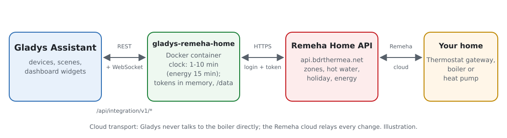
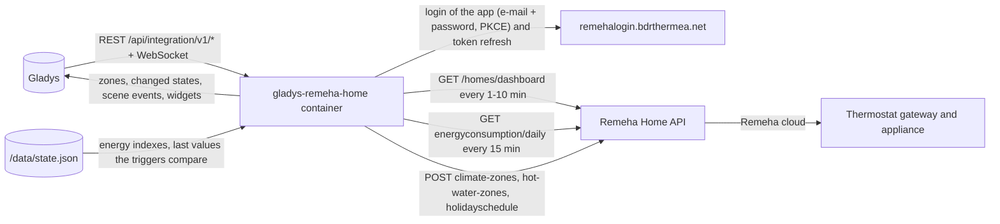
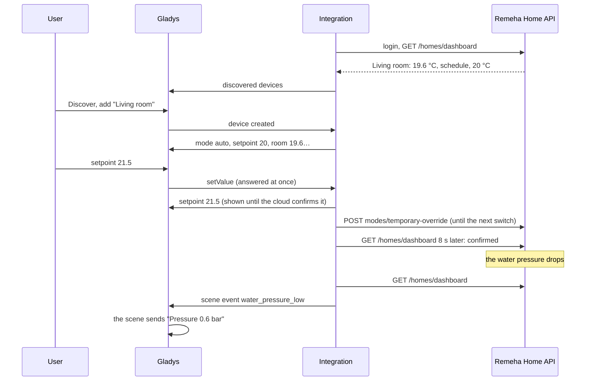

# Gladys Remeha Home

**English** · [Français](README.fr.md) · [Deutsch](README.de.md) · [Español](README.es.md)

[](LICENSE)
[](https://github.com/William-De71/gladys-remeha-home/releases)
[](https://github.com/William-De71/gladys-remeha-home/actions/workflows/release.yml)
[](https://gladysassistant.com)



[Gladys Assistant](https://gladysassistant.com) external integration for **Remeha Home**: every heating zone as a thermostat, the hot water as a water heater with its boost, and the boiler or heat pump with its water pressure, outdoor temperature and energy index. It signs in with your Remeha Home account, adds scene triggers (fault, low pressure, offline, holiday) and actions (temporary temperature, clock program, holiday, boost), and three dashboard widgets.

User documentation: [English](docs/en.md) · [Français](docs/fr.md) · [Deutsch](docs/de.md) · [Español](docs/es.md).

Not affiliated with Remeha nor BDR Thermea. BDR Thermea publishes **no documentation** for the service behind the Remeha Home app: the login and the requests are the ones the community integration for Home Assistant uses and documents ([msvisser/remeha_home](https://github.com/msvisser/remeha_home) and its maintained fork [hugo-leij/remeha_home](https://github.com/hugo-leij/remeha_home)), and they may change without notice. **Not tested with a real Remeha account yet**: please report what works and what does not.

## Features

- **One thermostat per climate zone**: mode (schedule, manual, off), setpoint within the bounds of the zone, heating demand (`operating-state`), room temperature, fireplace mode when the zone has one.
- **One water heater per hot water zone**: schedule, comfort, eco and boost, comfort temperature, heating or not, water temperature of a tank.
- **One device per appliance**: water pressure, outdoor temperature (sensor or weather service) and an **energy index** for the Gladys energy dashboard, from the daily estimate of Remeha.
- Every zone read in **one request** every 1, 2, 5 or 10 minutes; the energy every 15 minutes, the model name once. Commands shown at once and confirmed by the next reading.
- **5 scene triggers**, **5 scene actions** and **3 dashboard widgets** (below), a **Test the connection** button.
- Four languages everywhere: English, French, German, Spanish.

## How it works





From a setpoint to a scene:



### Transport

`transports: ["cloud"]`: the login goes to `remehalogin.bdrthermea.net` and every request to `api.bdrthermea.net`, with your Remeha Home account; the Remeha cloud relays the changes to the gateway of the thermostat. The app offers no local access. The password and the tokens stay in memory; `/data` keeps the energy index of each appliance, the figures of the last days, the model names and the last values the scene triggers compare.

## Devices and features

| Device    | Feature             | Category / type                       | Unit / values                  | Writable |
| --------- | ------------------- | ------------------------------------- | ------------------------------ | -------- |
| Zone      | Mode                | `thermostat` / `mode`                 | auto (schedule), manual, off   | yes      |
| Zone      | Setpoint            | `thermostat` / `target-temperature`   | °C, bounds of the zone, by 0.5 | yes      |
| Zone      | Heating demand      | `thermostat` / `operating-state`      | idle, heating, cooling         | no       |
| Zone      | Room temperature    | `temperature-sensor` / `decimal`      | °C                             | no       |
| Zone      | Fireplace mode      | `switch` / `binary`                   | on / off (zones that have it)  | yes      |
| Hot water | Hot water mode      | `water-heater` / `mode`               | program, manual, eco, boost    | yes      |
| Hot water | Comfort temperature | `water-heater` / `target-temperature` | °C, bounds of the zone, by 1   | yes      |
| Hot water | Heating water       | `water-heater` / `heating`            | 0 / 1                          | no       |
| Hot water | Water temperature   | `temperature-sensor` / `decimal`      | °C (a tank only)               | no       |
| Appliance | Water pressure      | `pressure-sensor` / `decimal`         | bar                            | no       |
| Appliance | Outdoor temperature | `temperature-sensor` / `decimal`      | °C                             | no       |
| Appliance | Energy consumed     | `energy-sensor` / `index`             | kWh (cumulated)                | no       |

A new setpoint on a zone that follows its schedule is a **temporary override** until the next switch, as in the app; on a manual or switched-off zone, a fixed manual setpoint. "Manual" for the hot water is the Comfort mode of the app (comfort all the time), "eco" its Eco mode. Remeha accepts a boost only from the schedule: the integration switches to the schedule first when needed. The energy is a daily estimate of Remeha, about 2 hours late: the integration adds what is new of each day into an index kept in `/data`; on a hybrid it adds the gas and the electricity, as Remeha does.

## Scene triggers, actions and widgets


Widgets:

- **Remeha zones**: temperature, setpoint and mode of each zone and of the hot water, a badge (heating, cooling, command being sent), the next switch and the program on tap, **Back to schedule** and **Hot water boost**, **Refresh**. Settings: the zones to show (8 at most).
- **Remeha energy**: energy of today and yesterday, bar chart of the last 7 days by use. Settings: the appliances to count.
- **Remeha appliance**: water pressure, outdoor temperature, connection, status, what the appliance does now, holiday, **Refresh**. Settings: the appliance.

Scene triggers (each one filtered by appliance): the appliance reports a fault, is back to normal, the water pressure gets too low, the appliance goes offline or back online, a holiday starts or ends (set in the app, never by the action).

Scene actions: set a temporary temperature (for a duration or until the next switch), choose clock program 1, 2 or 3, set the holiday mode (from today for N days, 0 to cancel), start a hot water boost, read Remeha Home now.

Examples:

- When someone comes home early → set the living room to 21 °C for 120 minutes.
- When the water pressure gets too low → notify "Pressure {{triggerEvent.data.pressure}} bar".
- When the appliance goes offline → notify, and check the gateway of the thermostat.

## Requirements

- Gladys Assistant **5.3.0** or later (older instances cannot install it).
- A Remeha appliance (or Baxi, De Dietrich, Brötje on the same cloud) shown in the Remeha Home app with its connected thermostat, and the e-mail and password of the app.

## Installation

- **From the store**: Integrations → Remeha Home → Install.
- **From the repository URL**: Integrations → external integration → `https://github.com/William-De71/gladys-remeha-home`.
- **Developer mode**: run `npm start` with the variables given by Gladys (see Development).

## Configuration

| Field or button              | Default   | Meaning                                                                  |
| ---------------------------- | --------- | ------------------------------------------------------------------------ |
| E-mail                       | —         | Required, the e-mail of the Remeha Home account                          |
| Password                     | —         | Required, a secret: kept in memory, never shown again, never logged      |
| Reading interval             | 2 min     | 1, 2, 5 or 10 minutes; one request for every zone                        |
| Language of the device texts | automatic | Feature names and button messages                                        |
| Test the connection          | —         | Signs in now and lists the zones, the hot water and the appliances found |

## Usage

1. Enter the e-mail and the password, then press **Test the connection** (Integrations → Remeha Home → Configuration).
2. **Discover**, then add the zones, the hot water and the appliance.
3. Add the **Remeha zones** and **Remeha appliance** widgets to a dashboard.
4. Build scenes with the device features, the triggers and the actions.

## Development

```bash
npm install
npm test                       # node --test, never touches the network
npm run lint                   # ESLint
npm run format:check           # Prettier
npx github:GladysAssistant/integration-store . --skip-image-check
scripts/build-cover.sh         # cover.jpg from docs/assets/cover.svg
docs/illustrations/render.sh   # docs/assets/widgets.<lang>.png
```

Locally, the SDK reads `GLADYS_HOST_API_URL`, `GLADYS_INTEGRATION_TOKEN` and `GLADYS_INTEGRATION_SELECTOR` (given by Gladys in developer mode), and the integration reads `TZ` (the language guess, and the days when Remeha gives no timezone). `DEBUG=gladys-integration-sdk` shows the SDK logs.

The tests cover the API client (the login of the app with its cookies, CSRF and PKCE, token reuse and refresh, a refused refresh token, wrong credentials, 401 / 429 / problem details, unreachable service, spacing, the bodies of the writes), the data model (fields read defensively, local times with a Z, modes, setpoints, the daily energy counted once), the devices (the fields the Discovery screen requires, category / type pairs), the scene triggers, the widgets (`validateWidgetContent`), the manifest, the four languages, the release script, and the whole integration against the fake Gladys of the SDK and a fake API (commanded values, refusals, slow-down, restart). `test/structure.test.js` freezes every key users store.

## Release process


Every merge on `main` runs the CI, then computes the version from the [Conventional Commits](https://www.conventionalcommits.org/) since the last tag: `feat` → minor, `fix` / `perf` → patch, `!` or `BREAKING CHANGE` → major (a minor below 1.0.0); `docs`, `chore`, `ci`, `test`, `style`, `refactor`, `build` alone publish nothing. The changelog section is generated, the tag pushed, the multi-architecture image built, then `main` receives the release commit, the GitHub Release is created and a last job checks the public image, the store validator and the topic.

- The pull request title becomes the squash commit, then the changelog line: write it in English, for the user (`pr-title.yml` checks it). Never edit `CHANGELOG.md` by hand.
- 1.0.0 is a decision: Actions → Release → Run workflow with `release-as: 1.0.0`. `dry-run` shows the version and the notes without publishing.
- **Protected branch**: rulesets require a pull request on `main` and lock the `v*` tags; only the maintainer and deploy keys get through. The release pushes with the deploy key of the `release` environment (secret `RELEASE_DEPLOY_KEY`, `main` only): a run from another branch never gets it. `build.yml` and `github-release.yml` do not start on a tag: the release calls them, or run them by hand (Actions → Run workflow, with `version` for the image) to finish a release.
- After the first release, make the `ghcr.io` package public (Package settings → Change visibility), or Gladys cannot pull it.

## Troubleshooting

See [docs/en.md](docs/en.md#troubleshooting). Report issues with the versions of Gladys and of the integration, the model of your appliance and thermostat, the result of "Test the connection" and the logs of the integration. Never paste your e-mail nor your password.

## Contributing

Issues and pull requests are welcome. Run `npm run format:check && npm run lint && npm test` before opening a pull request, and keep every external id and stored key unchanged (see [CLAUDE.md](CLAUDE.md)).

## Security

See [SECURITY.md](SECURITY.md): report vulnerabilities privately. The password is a `secret` field: never logged, never written to `/data`, sent only to `remehalogin.bdrthermea.net` over HTTPS to sign in; the tokens stay in memory and neither they nor the password appear in an error message. BDR Thermea offers no separate access for third parties: the integration holds the password of your account, so change it in the Remeha Home app to revoke the access.

## Screenshots to come

The images above are illustrations, not screenshots. Real screenshots will go in `docs/assets/screenshots/` (PNG, 1280 × 800): `configuration.png` (credentials and "Test the connection"), `discovery.png`, `thermostat.png` (a zone on the dashboard), `scene.png`.

## License

[Apache License 2.0](LICENSE) — see also [NOTICE](NOTICE). Remeha, Baxi, De Dietrich and Brötje are trademarks of the BDR Thermea Group. The API facts come from [msvisser/remeha_home](https://github.com/msvisser/remeha_home) and [hugo-leij/remeha_home](https://github.com/hugo-leij/remeha_home), credited in NOTICE; no code was copied. Thanks to the Gladys documentation and SDK.
